# Runsheet for iPhone

An unofficial GTA VI companion, built natively in SwiftUI. Plan a session from your chapter, character, in-game time and how long you can play, find what's left on a map of 574 places, and run it stop by stop with a Live Activity on your lock screen.

It's the native version of the [Runsheet web app](https://alireza12t.github.io/gta6-runsheet/). All your progress stays on your iPhone. No account, no server.

> Not affiliated with Rockstar Games or Take-Two Interactive. This is a fan-made guide with no Rockstar art, logos or fonts.

| Plan | Live board | Map | Place |
|---|---|---|---|
| 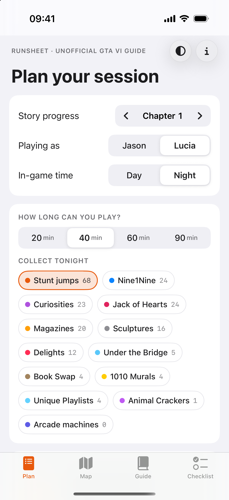 | 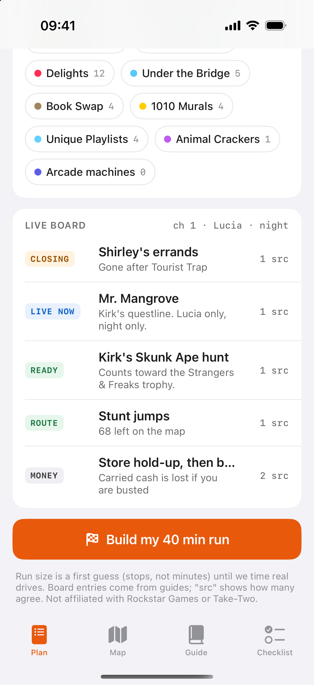 | 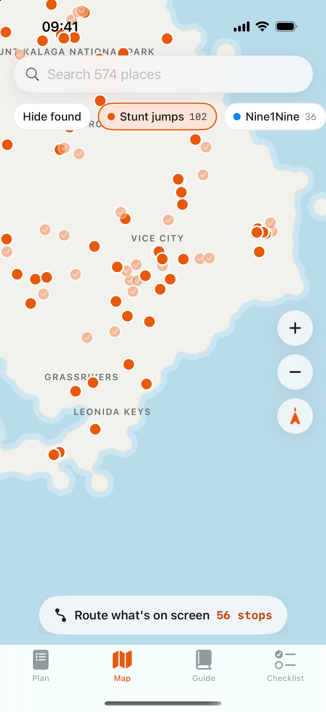 | 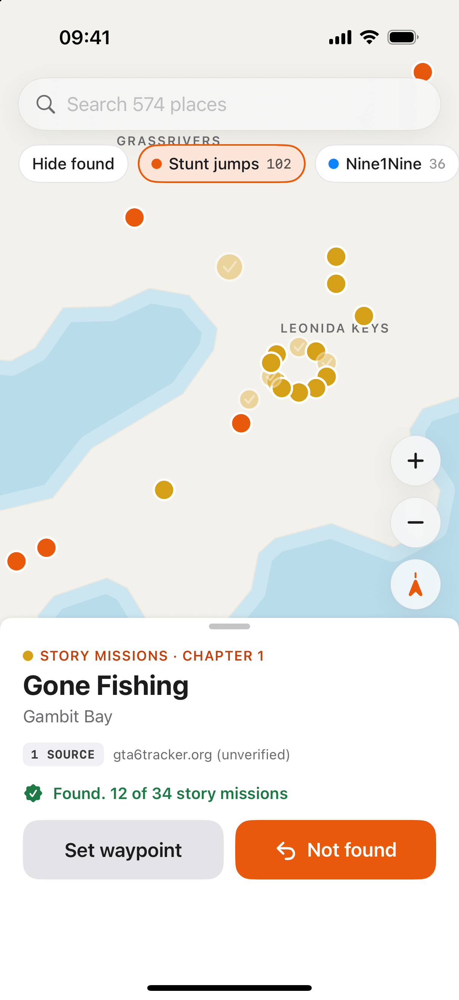 |

| Run | Lock screen | Guide | Checklist |
|---|---|---|---|
| 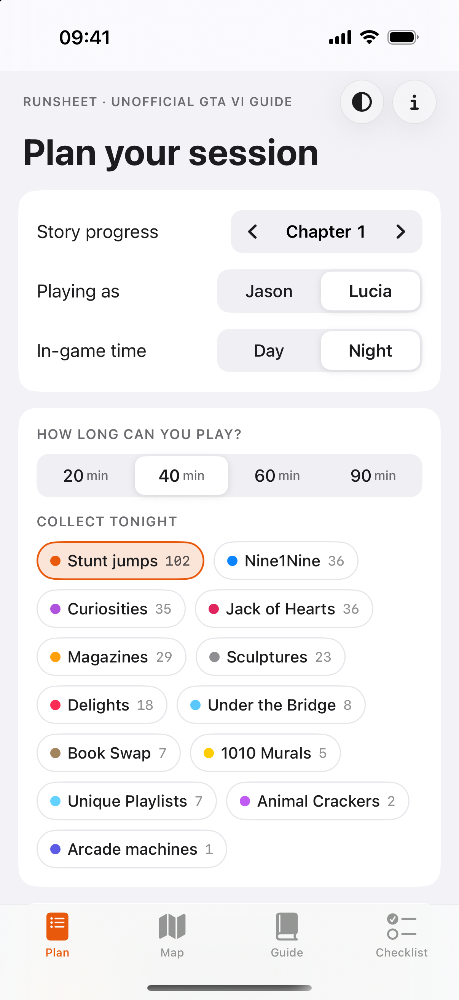 | 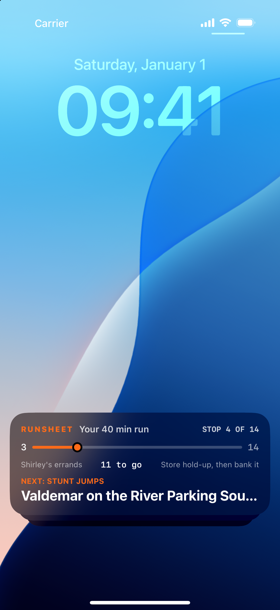 | 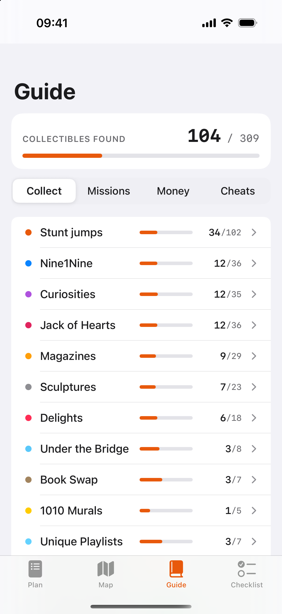 | 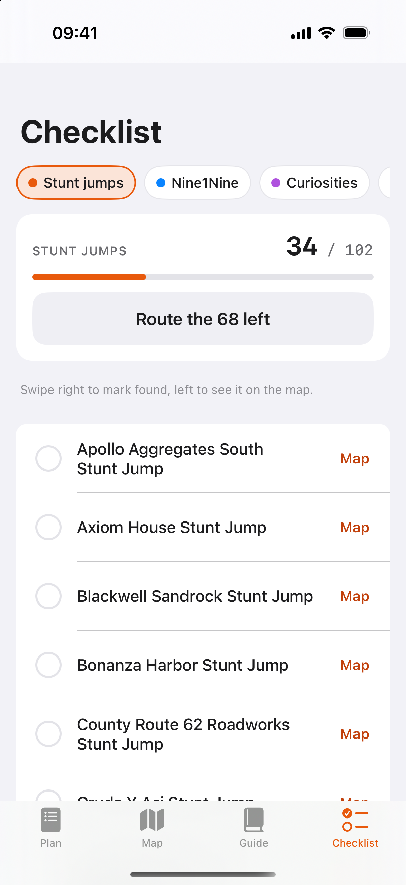 |

Dark mode:

| Plan | Map | Run | Missions |
|---|---|---|---|
| 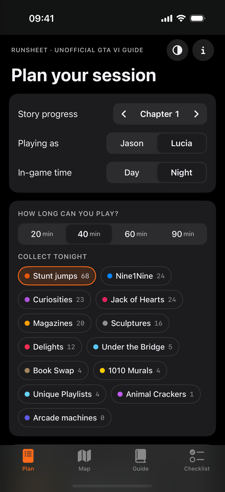 | 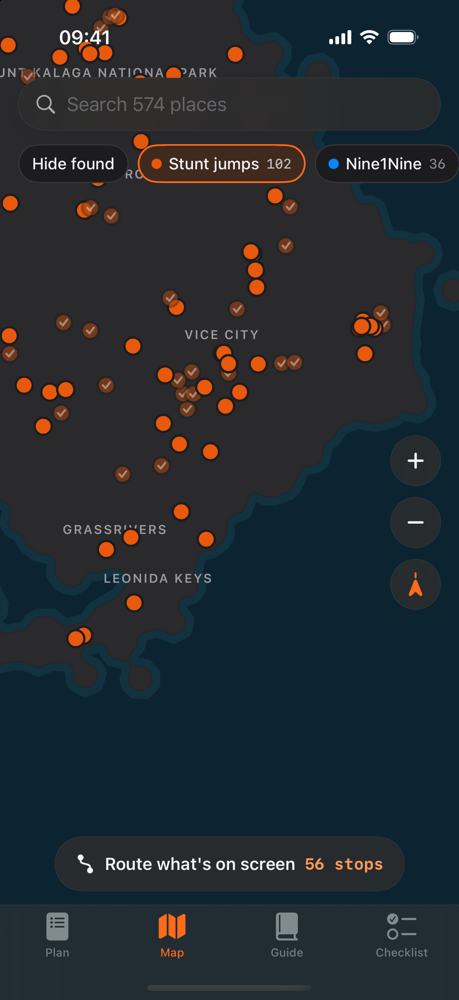 | 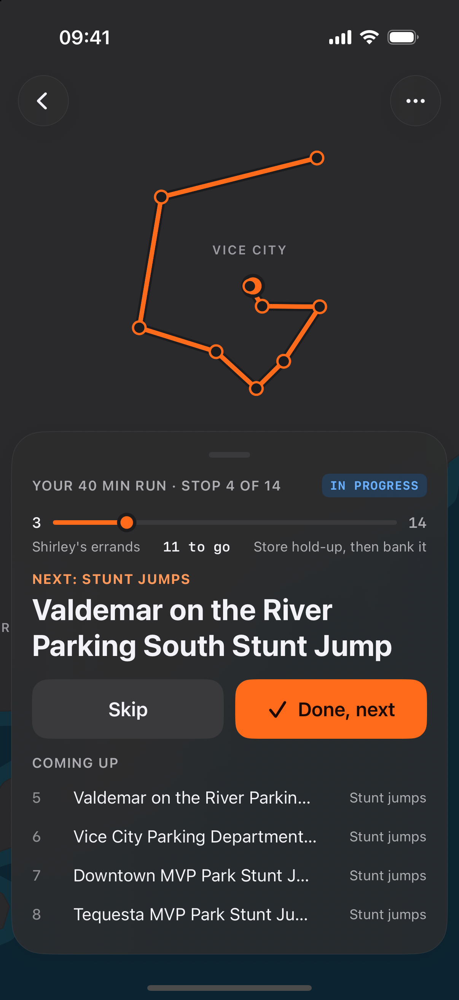 | 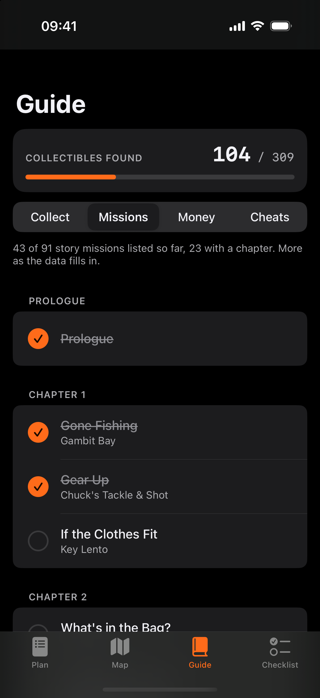 |

Loading screen:

| Trace | Fill |
|---|---|
| 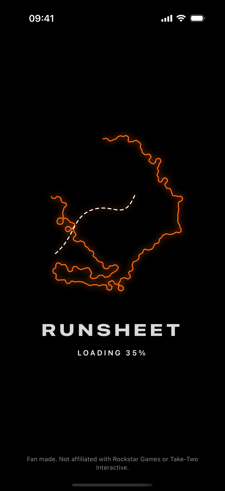 | 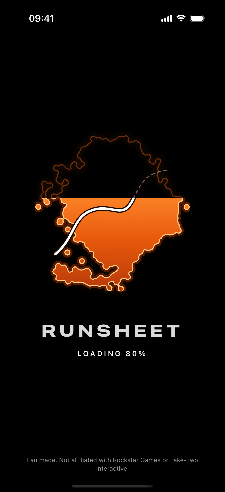 |

## What it does
- **Plan.** Pick chapter, Jason or Lucia, day or night, and 20 to 90 minutes. The live board shows what's open right now, like a departure board: blue is live now, amber is closing, green is ready, grey is money. Each line shows how many sources agree.
- **Run.** A route through the nearest unfound places (nearest neighbour, then 2-opt), drawn on the map as it starts. Done and Skip move you along, with haptics. The Live Activity and Dynamic Island show the next stop and a progress line.
- **Map.** Our own zoomable map of Leonida, drawn with SwiftUI Canvas. Pinch, pan, double tap. Pins are coloured by category. Filter, search, set a waypoint, mark found, or route whatever is on screen.
- **Guide.** Collectible progress, missions by chapter, Strangers & Freaks, money rules and ways to earn, cheats and trophies.
- **Checklist.** Every collectible and money spot by category. Swipe right to mark found, swipe left to see it on the map.

## Build it
Needs Xcode 26 or newer. The app runs on iOS 18 and up. On iOS 26 it uses native Liquid Glass (`glassEffect`, glass tab bar and buttons); on iOS 18 it falls back to materials.

1. Open `Runsheet.xcodeproj`.
2. Pick a simulator, or set your own team under Signing & Capabilities for a real iPhone.
3. Run.

The project file comes from `project.yml`. If you change targets or settings, regenerate it with:

```bash
xcodegen generate
```

Run the tests with `Cmd+U`, or:

```bash
xcodebuild test -project Runsheet.xcodeproj -scheme Runsheet -destination 'platform=iOS Simulator,name=iPhone 16 Pro'
```

### Launch arguments for screenshots
`-RSSkipLoading`, `-RSTab map|guide|checklist`, `-RSGuide missions|money|cheats`, `-RSPlace <id>`, `-RSDemoRun`, `-RSRunSteps <n>`, `-RSScrollBoard`, `-RSHoldLoading <0..1>`. Add `-RSEphemeral` so nothing is saved, and `-RSDemoFound` to tick a sample of places.

## How it's put together
| Folder | What's in it |
|---|---|
| `Runsheet/Data` | Codable models for the bundled JSON, the route solver, saved state, and the store with the plan board rules |
| `Runsheet/Screens` | Plan, Map (Canvas map and gestures), Run, Guide, Checklist, About |
| `Runsheet/Design` | Colours, Liquid Glass with a material fallback, tags, chips, the progress line |
| `Runsheet/Loading` | The launch animation |
| `RunsheetWidgets` | The Live Activity and Dynamic Island |
| `Shared` | The Live Activity attributes, used by both targets |
| `Runsheet/Resources` | `places.json`, `guide.json`, `tonight.json`, `money.json`, `outline.json` |

Progress is a single JSON file in Application Support. If it can't be read, the app moves it aside and starts fresh. It never deletes it.

## Credits
- **Map locations** come from [gta6tracker.org](https://gta6tracker.org), which builds on the GTA Wiki (CC BY-SA). They're marked unverified in the app, exactly as the data says. The location data keeps its CC BY-SA terms.
- **Plan items, missions, cheats and money tips** are hand-written from guide summaries. No payout numbers are shown, because none are confirmed.
- **The map outline** is our own schematic drawing, not Rockstar's map.
- **The loading animation** is adapted from [gta6-countdown](https://github.com/alireza12t/gta6-countdown) (MIT). It traces the Leonida outline instead of the game's logo.
- Design inspired by Flighty's departure-board layout. No Flighty assets are used.

## License
The app code is MIT licensed, see [LICENSE](LICENSE). The location data in `places.json` is CC BY-SA, from the GTA Wiki via gta6tracker.org.

Grand Theft Auto and GTA are trademarks of Take-Two Interactive. This project isn't endorsed by or connected to Rockstar Games or Take-Two Interactive.
